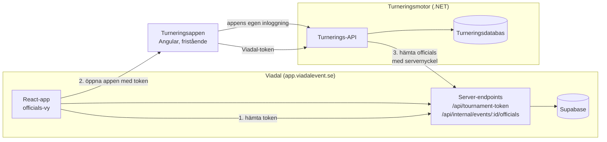

# ADR-0005: Turneringsappens backend blir en delad turneringsmotor för Viadal

|                |                                                                       |
| -------------- | --------------------------------------------------------------------- |
| Status         | Föreslagen                                                            |
| Datum          | 2026-11-13                                                            |
| Berör          | Turneringsappen (.NET + Angular) och Viadal (React/HeroUI + Supabase) |
| Beslutsfattare | Frida                                                                 |

Lägg den här filen i båda repona, under `docs/adr/`. Avsnitt markerade **[att verifiera]** bygger på antaganden om nuvarande kod som ska kontrolleras innan implementation.

---

## 1. Bakgrund

- Turneringsappen är en fristående app för utslagsturneringar mellan kollegor: .NET-backend, Angular-framände och egen databas. Den ska fortsätta leva på egen hand.
- Viadal är en multi-tenant-app för sportevent med tre kundnivåer: **standard, premium och professional**.
- Idé: officials (de som arbetar under ett event) ska kunna köra turneringar mellan sig, till exempel under raster. Funktionen ska ingå i **premium och professional, inte i standard**.
- De två systemen är byggda på olika plattformar med olika databaser och olika inloggning.

Frågan är hur turneringsfunktionen ska komma in i Viadal utan att reglerna för turneringar (lottning, byes, deadlines, matchlägen, konflikter) behöver finnas på två ställen.

## 2. Beslut

**Turneringsappens .NET-backend blir en turneringsmotor som kan betjäna flera klienter.**

- Den fristående turneringsappen och Viadal är båda klienter till samma motor.
- Varje turnering hör till ett **sammanhang** (fristående eller ett specifikt Viadal-event). Motorn håller sammanhangen strikt isär.
- Viadal-användare loggar in i motorn med en **kortlivad token som Viadal utfärdar**. Viadal kontrollerar kundens nivå innan token utfärdas.
- Motorn sparar Viadals officials som **externa referenser**, inte som egna användare.
- Införandet sker stegvis: först länkas den befintliga Angular-appen in från Viadal (steg 3 nedan). En egen turneringsmodul i Viadal, byggd i React och HeroUI, byggs först när funktionen visat sig användas (steg 4).

## 3. Alternativ som övervägts

| Alternativ                                                     | Varför inte (eller inte nu)                                                                                                                                 |
| -------------------------------------------------------------- | ----------------------------------------------------------------------------------------------------------------------------------------------------------- |
| 1. Bara länk med SSO, inga ändringar i motorn                  | Snabbast, men leder till en återvändsgränd: motorn vet inget om sammanhang eller externa spelare. Ingår som första leverans, men byggt enligt detta beslut. |
| 2. Angular-appen som webbkomponent (Angular Elements) i Viadal | Två ramverk på samma sida, stor kodmängd, krockande stilar (Tailwind och Angular Material).                                                                 |
| 3. **En motor, två framändar**                                 | **Valt.** Reglerna finns på ett ställe och det känns inbyggt i Viadal på sikt. Priset är två framändar att underhålla.                                      |
| 4. Bygga om allt i Viadal (Supabase + React)                   | Reglerna hamnar i två kodbaser som glider isär, eftersom den fristående appen ska finnas kvar.                                                              |

## 4. Arkitektur



Drift: motorn körs som en egen container app i samma Azure Container Apps-miljö som Viadal (samma region, `swedencentral`), med en egen subdomän, till exempel `turnering.viadalevent.se`.

## 5. Ändringar i turneringsmotorn

### 5.1 Sammanhang på varje turnering

| Fält          | Typ                           | Exempel          |
| ------------- | ----------------------------- | ---------------- |
| `ContextType` | enum `Standalone` / `Viadal`  | `Viadal`         |
| `ContextId`   | string, null för `Standalone` | Viadals event-id |

- **Varje** fråga mot turneringar filtreras på sammanhanget från inloggningen, aldrig på ett värde som klienten skickar. Lägg det som ett globalt filter (EF Core query filter) så att det inte kan glömmas bort.
- Det ska finnas tester som bevisar att en användare i ett sammanhang inte kan läsa eller ändra något i ett annat.

### 5.2 Externa spelare

| Fält          | Typ                                                  | Exempel                 |
| ------------- | ---------------------------------------------------- | ----------------------- |
| `ExternalRef` | string, unik per sammanhang, null för egna användare | `viadal:official:8f3c…` |
| `DisplayName` | string                                               | `Anna Berg`             |

- En spelare är antingen en egen användare i turneringsappen eller en extern referens.
- Namnet sparas för visning. Det uppdateras när spelarlistan hämtas på nytt från Viadal.

### 5.3 Inloggning: två scheman

Motorn tar emot två slags tokens, som två autentiseringsscheman i ASP.NET Core:

| Schema       | Utfärdare                                                                            | Används av           |
| ------------ | ------------------------------------------------------------------------------------ | -------------------- |
| `Standalone` | Microsoft Entra ID (inloggning med jobbmejl), validerat med `Microsoft.Identity.Web` | Den fristående appen |
| `Viadal`     | Viadal, se 6.1                                                                       | Officials via Viadal |

Rättigheter beräknas av motorn utifrån token och turneringens data, enligt rolltabellen i `design/SPEC.md` §2. I Viadal-sammanhang gäller dessutom:

- **Begränsningen är eventet.** Bara officials som är anmälda och bekräftade (`invite_status = confirmed`) på just det eventet kan se, starta, spela och följa eventets turneringar. Det gäller även andra officials hos samma kund: att vara official på ett annat event ger ingen åtkomst.
- En official som är anmäld på flera event har separata turneringar per event. Token gäller ett event åt gången (`ctx`), så man byter event i Viadal för att se det eventets turneringar.
- **Inbjudna** finns inte i Viadal-sammanhang. Alla eventets officials kan se eventets turneringar.
- Spelarregistret är eventets officials. Det går inte att lägga till eller ta bort spelare från turneringsmotorn.
- Eventets **admin har ingen särskild roll** i officials turneringar: admin kan varken se, rensa eller ta bort dem (om admin inte själv är official på eventet och deltar som vanligt).

### 5.4 Samtidighet

Varje match har en version (`RowVersion`). Den som markerar en vinnare skickar versionen hon såg (`If-Match`). Är den inaktuell svarar motorn `409 Conflict`, och klienten visar "Någon hann före" enligt SPEC.md §7.

Det finns **ingen realtidsuppdatering** (ingen SignalR eller polling). Klienten hämtar data när en vy öppnas och när användaren drar för att uppdatera. Krockar fångas av versionskontrollen ovan.

### 5.6 Official som tas bort mitt i en turnering

Om en official tas bort från eventet (`invite_status = removed`) medan en turnering pågår:

- Officialens plats i matcher som **inte är avgjorda** blir en **bye**. Motståndaren går vidare automatiskt.
- Matcher som redan är avgjorda eller låsta lämnas orörda, så att trädet fortfarande går att följa.
- Motorn upptäcker borttagningen genom att hämta spelarlistan från Viadal (6.2) när en pågående turnering öppnas, cachat några minuter. En spelare som saknas i listan räknas som borttagen. Viadal behöver inte meddela motorn separat.

### 5.7 Gallring

Turneringar i Viadal-sammanhang **raderas ett år efter att turneringen avslutats**, inklusive spelarnas namn och referenser. Ett schemalagt jobb i motorn sköter det, till exempel en gång per dygn. Turneringar i den fristående appen omfattas inte av den regeln.

### 5.5 API-ytor (förslag)

| Metod    | Sökväg                        | Syfte                                                                       |
| -------- | ----------------------------- | --------------------------------------------------------------------------- |
| `GET`    | `/api/tournaments`            | Turneringar i inloggningens sammanhang                                      |
| `POST`   | `/api/tournaments`            | Skapa (namn, slutdatum, spelare)                                            |
| `POST`   | `/api/tournaments/{id}/draw`  | Lotta                                                                       |
| `GET`    | `/api/tournaments/{id}`       | Turnering med träd, rundor och matcher                                      |
| `PUT`    | `/api/matches/{id}/winner`    | Sätt eller byt vinnare (`If-Match`)                                         |
| `DELETE` | `/api/matches/{id}/winner`    | Ångra vinnare (`If-Match`)                                                  |
| `POST`   | `/api/tournaments/{id}/clear` | Rensa resultat (arrangör)                                                   |
| `DELETE` | `/api/tournaments/{id}`       | Ta bort (arrangör)                                                          |
| `GET`    | `/api/players`                | Tillgängliga spelare i sammanhanget. I Viadal hämtas de från Viadal, se 6.2 |

Publicera API:t som OpenAPI. Det blir kontraktet för både Angular-appen och en framtida Viadal-modul.

## 6. Ändringar i Viadal

### 6.1 Token för turneringar: `POST /api/tournament-token`

En server-endpoint som körs med officialens vanliga Supabase-session.

1. Hämtar kundens nivå. Om den är `standard`: svarar `403`. Fliken Turneringar ska då inte heller visas i gränssnittet.
2. Kontrollerar att officialen är bekräftad (`invite_status = confirmed`) på eventet.
3. Signerar en JWT:

| Claim    | Värde                          |
| -------- | ------------------------------ |
| `iss`    | `https://app.viadalevent.se`   |
| `aud`    | `tournament-engine`            |
| `sub`    | `viadal:official:{officialId}` |
| `name`   | Officialens visningsnamn       |
| `ctx`    | `viadal:event:{eventId}`       |
| `tenant` | Tenant-id                      |
| `tier`   | `premium` eller `professional` |
| `exp`    | Nu + 15 minuter                |

- Signera asymmetriskt (ES256 eller RS256). Den privata nyckeln finns bara i Viadal. Viadal publicerar den publika nyckeln på `/.well-known/jwks.json`, och motorn hämtar den därifrån. Det gör nyckelbyte möjligt utan nya deploys.
- Klienten hämtar en ny token innan den gamla går ut.

### 6.2 Spelarlista: `GET /api/internal/events/{eventId}/officials`

- Anropas bara av motorn, server till server, med en servernyckel. Nyckeln förvaras som hemlighet i Azure och i 1Password, inte i koden.
- Returnerar bekräftade officials: `id`, `displayName`. Inga telefonnummer eller e-postadresser. Motorn behöver dem inte.

### 6.3 Gränssnitt

- En flik **Turneringar** i officials mobilvy, som bara visas för premium och professional.
- Steg 3: fliken öppnar turneringsappen med token. Steg 4: fliken är en egen React-modul.

## 7. Hur token kommer över (steg 3)

Viadal öppnar turneringsappen på `https://turnering.viadalevent.se/viadal#token=…`.

- Token ligger i URL-fragmentet (efter `#`). Fragment skickas inte till servrar och hamnar inte i serverloggar.
- Angular-appen läser fragmentet, sparar token i minnet (inte i localStorage) och tar bort fragmentet ur adressfältet direkt.
- När token håller på att gå ut ber appen Viadal om en ny via `postMessage`, eller skickar officialen tillbaka till Viadal.
- **Inbäddning (iframe) väljs bort i steg 3.** Den kräver CSP-regler för `frame-ancestors`, krånglar med kakor och ger dålig mobilupplevelse. Ny flik eller samma fönster räcker.

## 8. Nivåer

|                                                                                                                                                                          | Standard | Premium | Professional |
| ------------------------------------------------------------------------------------------------------------------------------------------------------------------------ | -------- | ------- | ------------ |
| Turneringar mellan officials                                                                                                                                             | –        | ✓       | ✓            |
| Extra (välj en eller två senare): admin-turneringar som del av eventet, matchförslag utifrån pass och tillgänglighet, resultattavla för storskärm, historik mellan event | –        | –       | ✓            |

## 9. Införande

| Steg                    | Innehåll                                                           | Klart när                                                                                    |
| ----------------------- | ------------------------------------------------------------------ | -------------------------------------------------------------------------------------------- |
| 1. Motor med sammanhang | 5.1, 5.2, 5.4 och globalt filter, gärna som del av refaktoreringen | Fristående appen fungerar som förut. Testerna för isolering mellan sammanhang går igenom.    |
| 2. Viadal-inloggning    | 5.3, 6.1, 6.2, JWKS                                                | Motorn accepterar en Viadal-token och listar eventets officials. En standard-kund får `403`. |
| 3. Inlänkning           | 6.3 och 7, med appen i Viadal-tema via design-tokens               | Officials på ett premium-event kan skapa, lotta och spela en turnering från Viadal.          |
| 4. Viadal-modul         | React/HeroUI-modul mot samma API                                   | Görs bara om steg 3 visar att funktionen används.                                            |

## 10. Konsekvenser

**Bra**

- Turneringsreglerna finns på ett ställe.
- Viadal behöver inte känna till turneringsdatabasen, och motorn behöver inte känna till Supabase.
- Nivåkontrollen ligger där kundens nivå finns, alltså i Viadal.
- Steg 3 går att bygga utan att Viadals gränssnitt ändras mer än med en flik.

**Mindre bra**

- En tjänst till att drifta, övervaka (Sentry) och hålla vid liv.
- Två framändar att underhålla från steg 4.
- Spelarnamn är en kopia som kan bli inaktuell tills listan hämtas igen.

## 11. Besvarade frågor (2026-11-13)

| Fråga                                                        | Beslut                                  | Se  |
| ------------------------------------------------------------ | --------------------------------------- | --- |
| Ska eventets admin se och kunna rensa officials turneringar? | Nej                                     | 5.3 |
| Hur länge sparas turneringar efter ett event?                | Ett år efter att turneringen avslutats  | 5.7 |
| Vad händer om en official tas bort mitt i en turnering?      | Platsen blir en bye                     | 5.6 |
| Behövs realtidsuppdatering?                                  | Nej                                     | 5.4 |
| Hur loggar man in i den fristående appen?                    | Microsoft-konto med jobbmejl (Entra ID) | 5.3 |

## 12. Öppna frågor

1. **Inbjudna utanför företaget i den fristående appen.** Med inloggning via jobbmejl: hur loggar en person från ett annat företag in? Alternativ: (a) bjuda in dem som gäster i företagets Entra ID (B2B), (b) låta appen ta emot alla Microsoft-konton, arbete och privat, och styra åtkomst i appen, (c) en enkel inloggning med engångskod via e-post för inbjudna. Påverkar inte Viadal-integrationen, men behöver bestämmas innan rollen "Invited" byggs.
2. Turneringsappen använder en databas i Azure, antagen vara **Azure SQL Database** (vanligast ihop med .NET och EF Core) **[att bekräfta]**. Det ger följande:
   - **Versionskontroll (5.4):** SQL Server har en inbyggd kolumntyp, `rowversion`, som uppdateras automatiskt vid varje ändring. I EF Core blir det en `byte[]`-egenskap märkt `[Timestamp]`. EF Core kastar då `DbUpdateConcurrencyException` när versionen är inaktuell, och API:t översätter det till `409 Conflict`.
   - **Gallring (5.7):** körs som ett **Azure Container Apps Job** med schema (cron), i samma miljö som motorn. Jobbet raderar Viadal-turneringar som avslutades för mer än ett år sedan. Ett separat jobb i stället för en bakgrundstjänst i API:t gör att gallringen körs exakt en gång, även när API:t kör flera repliker.
   - Om det i stället är Cosmos DB används dokumentets `_etag` för versionskontrollen, och gallringen kan göras med inbyggd TTL (time to live) på dokumenten.

## 13. Till CLAUDE.md

**I turneringsappens repo:**

```md
## Integration med Viadal

- Läs docs/adr/ADR-001-turneringsmotor-viadal.md innan du rör auth, datamodell eller API.
- Varje turnering har ContextType/ContextId. Filtrera alltid på sammanhanget från
  inloggningen, aldrig på ett värde från klienten.
- Spelare kan vara externa (ExternalRef). Anta inte att en spelare är en egen användare.
```

**I Viadals repo:**

```md
## Turneringar (premium/professional)

- Läs docs/adr/0005-turneringsmotor-viadal.md.
- Turneringsdata ägs av turneringsmotorn. Lägg inga turneringstabeller i Supabase.
- /api/tournament-token och /api/internal/events/:id/officials är de enda integrationspunkterna.
```
